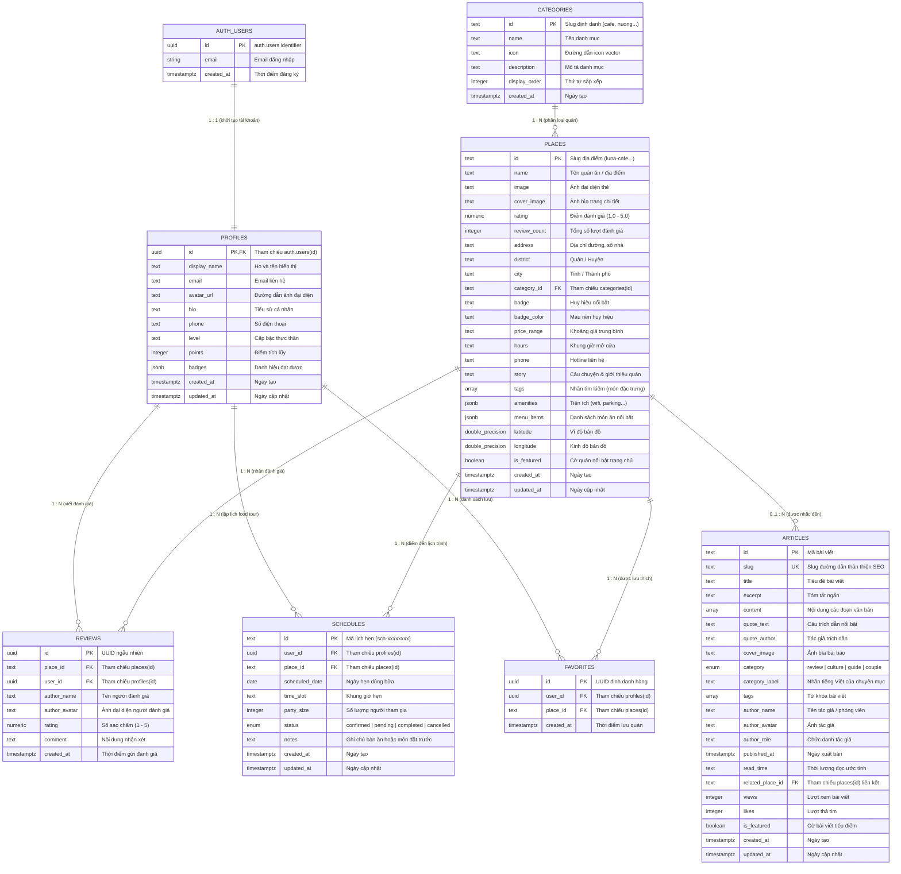

# Đặc Tả Kiến Trúc Cơ Sở Dữ Liệu & Sơ Đồ Thực Thể (ERD) - Dự Án HYUN

Tài liệu thiết kế kiến trúc cơ sở dữ liệu quan hệ cho nền tảng khám phá ẩm thực và phong cách sống **HYUN (Minkura)**, được xây dựng trên hệ quản trị cơ sở dữ liệu **PostgreSQL (Supabase)** kết hợp cùng **Next.js 15 App Router** và **Cloudflare R2**.

---

## 1. Sơ Đồ Quan Hệ Thực Thể (Mermaid ERD)

---

## 2. Phân Tích Mối Quan Hệ Giữa Các Thực Thể

| Thực thể gốc (1) | Thực thể đích (N) | Loại quan hệ | Ý nghĩa nghiệp vụ |
|---|---|:---:|---|
| `auth.users` | `profiles` | **1 : 1** | Mỗi tài khoản đăng ký Supabase Auth sở hữu đúng một bản ghi hồ sơ cá nhân (`id` trùng nhau, kích hoạt tự động qua Trigger `on_auth_user_created`). |
| `categories` | `places` | **1 : N** | Một danh mục ẩm thực (Cà phê, Lẩu nướng, Cơm, Vỉa hè...) phân loại nhiều quán ăn khác nhau. |
| `profiles` | `reviews` | **1 : N** | Một người dùng có thể gửi nhiều bài đánh giá trải nghiệm tại các quán ăn khác nhau. |
| `places` | `reviews` | **1 : N** | Một địa điểm nhận nhiều lượt chấm điểm và bình luận từ cộng đồng thực khách. |
| `places` | `articles` | **0..1 : N** | Một quán ăn có thể là nhân vật trung tâm được review trong nhiều bài báo ẩm thực (`related_place_id`). |
| `profiles` | `schedules` | **1 : N** | Một người dùng lên kế hoạch cho nhiều buổi hẹn ẩm thực / food tour theo ngày giờ. |
| `places` | `schedules` | **1 : N** | Một địa điểm có thể xuất hiện trong nhiều lịch trình khám phá của các người dùng khác nhau. |
| `profiles` | `places` (qua `favorites`) | **N : N** | Quan hệ nhiều-nhiều: Người dùng lưu nhiều quán tâm đắc; Mỗi quán được nhiều người yêu thích (được chuẩn hóa qua bảng trung gian `favorites` với ràng buộc `UNIQUE(user_id, place_id)`). |

---

## 3. Chi Tiết Từ Điển Dữ Liệu (Data Dictionary)

### 3.1. Bảng `profiles` (Hồ sơ người dùng)
- **`id`** (`UUID`, PK, FK): Khóa chính tham chiếu sang `auth.users(id)` (`ON DELETE CASCADE`).
- **`display_name`** (`TEXT`, NOT NULL): Tên hiển thị công khai.
- **`email`** (`TEXT`): Email người dùng.
- **`avatar_url`** (`TEXT`, DEFAULT `'/img/profile-avatar.png'`): Đường dẫn ảnh đại diện.
- **`bio`** (`TEXT`): Tiểu sử giới thiệu bản thân.
- **`phone`** (`TEXT`): Số điện thoại liên hệ.
- **`level`** (`TEXT`, DEFAULT `'Thực thần tập sự'`): Danh hiệu cấp bậc người dùng.
- **`points`** (`INTEGER`, DEFAULT `120`): Điểm thưởng tích lũy khi đánh giá và tương tác.
- **`badges`** (`JSONB`): Mảng huy hiệu đạt được (vd: `["Check-in 10 quán", "Thành viên tích cực"]`).
- **`created_at`** / **`updated_at`** (`TIMESTAMPTZ`): Dấu thời gian hệ thống.

### 3.2. Bảng `categories` (Danh mục ẩm thực)
- **`id`** (`TEXT`, PK): Slug mã định danh (`cafe`, `lau`, `nuong`, `com`, `streetfood`, `haisan`, `chay`, `trasua`, `banh`, `bun-pho`).
- **`name`** (`TEXT`, NOT NULL): Tên danh mục hiển thị (vd: Cà phê, Lẩu, Đồ nướng...).
- **`icon`** (`TEXT`): Đường dẫn ảnh vector icon danh mục.
- **`description`** (`TEXT`): Mô tả ngắn gọn về danh mục.
- **`display_order`** (`INTEGER`, DEFAULT `0`): Thứ tự ưu tiên sắp xếp trên giao diện.

### 3.3. Bảng `places` (Địa điểm quán ăn & cà phê)
- **`id`** (`TEXT`, PK): Slug định danh duy nhất (vd: `luna-cafe`, `sakura-restaurant`).
- **`name`** (`TEXT`, NOT NULL): Tên địa điểm.
- **`image`** (`TEXT`, NOT NULL): Ảnh hiển thị thẻ đại diện.
- **`cover_image`** (`TEXT`): Ảnh banner trang chi tiết quán.
- **`rating`** (`NUMERIC(3,1)`, DEFAULT `5.0`): Điểm đánh giá trung bình từ thực khách.
- **`review_count`** (`INTEGER`, DEFAULT `0`): Tổng số lượt đánh giá đã gửi.
- **`address`** (`TEXT`, NOT NULL): Số nhà, tên đường.
- **`district`** (`TEXT`, NOT NULL): Quận / Huyện (vd: Quận 1, Quận 3, Bình Thạnh...).
- **`city`** (`TEXT`, DEFAULT `'TP. Hồ Chí Minh'`): Tỉnh / Thành phố.
- **`category_id`** (`TEXT`, FK): Tham chiếu `categories(id)`.
- **`badge`** (`TEXT`) / **`badge_color`** (`TEXT`): Nhãn danh hiệu nổi bật và màu sắc hiển thị.
- **`price_range`** (`TEXT`): Khoảng giá trung bình (vd: `50.000đ - 150.000đ`).
- **`hours`** (`TEXT`): Khung giờ phục vụ (vd: `09:00 - 22:00`).
- **`phone`** (`TEXT`): Số điện thoại liên hệ đặt bàn.
- **`story`** (`TEXT`): Câu chuyện thương hiệu và giới thiệu chi tiết.
- **`tags`** (`TEXT[]`): Mảng từ khóa món ăn và đặc trưng quán.
- **`amenities`** (`JSONB`): Tiện ích đi kèm (Wifi, Điều hòa, Bãi đỗ ô tô, Thanh toán thẻ...).
- **`menu_items`** (`JSONB`): Danh sách các món ăn tiêu biểu kèm giá tiền.
- **`latitude`** / **`longitude`** (`DOUBLE PRECISION`): Tọa độ địa lý phục vụ định vị bản đồ số Leaflet.
- **`is_featured`** (`BOOLEAN`, DEFAULT `false`): Đánh dấu quán nổi bật xuất hiện tại trang chủ.

### 3.4. Bảng `reviews` (Đánh giá & nhận xét)
- **`id`** (`UUID`, PK): Mã định danh đánh giá sinh ngẫu nhiên `gen_random_uuid()`.
- **`place_id`** (`TEXT`, FK, NOT NULL): Tham chiếu `places(id)` (`ON DELETE CASCADE`).
- **`user_id`** (`UUID`, FK): Tham chiếu `profiles(id)` (`ON DELETE SET NULL`).
- **`author_name`** (`TEXT`, NOT NULL): Tên tác giả đánh giá.
- **`author_avatar`** (`TEXT`): Ảnh đại diện tác giả.
- **`rating`** (`NUMERIC(2,1)`, NOT NULL): Điểm số đánh giá, kiểm tra ràng buộc `1 <= rating <= 5`.
- **`comment`** (`TEXT`, NOT NULL): Nội dung bình luận chi tiết.
- **`created_at`** (`TIMESTAMPTZ`): Thời điểm gửi bài đánh giá.

### 3.5. Bảng `articles` (Tạp chí ẩm thực & bài viết)
- **`id`** (`TEXT`, PK): Mã bài viết.
- **`slug`** (`TEXT`, UNIQUE, NOT NULL): Đường dẫn thân thiện SEO.
- **`title`** (`TEXT`, NOT NULL): Tiêu đề bài viết.
- **`excerpt`** (`TEXT`, NOT NULL): Đoạn trích dẫn tóm tắt.
- **`content`** (`TEXT[]`, NOT NULL): Mảng chứa nội dung các đoạn văn bản.
- **`quote_text`** / **`quote_author`** (`TEXT`): Câu nói truyền cảm hứng và tác giả trích dẫn.
- **`cover_image`** (`TEXT`, NOT NULL): Ảnh bìa bài báo.
- **`category`** (`ENUM`): Phân loại bài viết (`review`, `culture`, `guide`, `couple`).
- **`category_label`** (`TEXT`, NOT NULL): Nhãn tiếng Việt tương ứng của chuyên mục.
- **`author_name`** / **`author_avatar`** / **`author_role`** (`TEXT`): Thông tin tác giả / phóng viên ẩm thực.
- **`published_at`** (`TIMESTAMPTZ`): Thời điểm xuất bản bài báo.
- **`read_time`** (`TEXT`, DEFAULT `'5 phút đọc'`): Thời gian đọc ước tính.
- **`related_place_id`** (`TEXT`, FK): Quán ăn liên kết trực tiếp (`places(id)`).
- **`views`** / **`likes`** (`INTEGER`): Lượt tương tác bài viết.

### 3.6. Bảng `schedules` (Lịch trình ẩm thực & Food Tour)
- **`id`** (`TEXT`, PK): Mã lịch hẹn theo định dạng `sch-xxxxxxxx`.
- **`user_id`** (`UUID`, FK): Tham chiếu `profiles(id)` (`ON DELETE CASCADE`).
- **`place_id`** (`TEXT`, FK, NOT NULL): Tham chiếu `places(id)` (`ON DELETE CASCADE`).
- **`scheduled_date`** (`DATE`, NOT NULL): Ngày diễn ra buổi hẹn.
- **`time_slot`** (`TEXT`, NOT NULL): Khung giờ hẹn (vd: `18:30 - 20:00`).
- **`party_size`** (`INTEGER`, DEFAULT `2`): Số người tham gia.
- **`status`** (`ENUM`): Trạng thái (`confirmed`, `pending`, `completed`, `cancelled`).
- **`notes`** (`TEXT`): Ghi chú chuẩn bị hoặc yêu cầu đặc biệt.

### 3.7. Bảng `favorites` (Quán yêu thích của người dùng)
- **`id`** (`UUID`, PK): Mã định danh bản ghi.
- **`user_id`** (`UUID`, FK, NOT NULL): Tham chiếu `profiles(id)` (`ON DELETE CASCADE`).
- **`place_id`** (`TEXT`, FK, NOT NULL): Tham chiếu `places(id)` (`ON DELETE CASCADE`).
- **Ràng buộc duy nhất**: `UNIQUE(user_id, place_id)` ngăn trùng lặp dữ liệu yêu thích.

---

## 4. Các Ràng Buộc & Tính Năng Nâng Cao Tích Hợp

### 4.1. Automatic Trigger: Tự Động Tính Điểm Đánh Giá Quán Ăn
Hệ thống sử dụng PostgreSQL Trigger `trigger_update_place_rating` kích hoạt trên bảng `reviews`:
- Khi có bất kỳ đánh giá mới (`INSERT`), sửa điểm (`UPDATE`) hoặc xóa nhận xét (`DELETE`), hàm `update_place_rating_stats()` sẽ tự động tính lại giá trị trung bình `AVG(rating)` làm tròn 1 chữ số thập phân và đếm lại tổng `COUNT(*)` lưu thẳng vào 2 cột `places.rating` và `places.review_count`.
- **Ưu điểm**: Tối ưu tốc độ đọc trang chủ và trang danh sách lên mức $O(1)$, không cần `JOIN` tính điểm khi hiển thị thẻ địa điểm.

### 4.2. Automatic Trigger: Tự Động Khởi Tạo Profile Khi Đăng Ký
Trigger `on_auth_user_created` trên bảng `auth.users`:
- Ngay khi người dùng xác thực thành công qua Email hoặc OAuth, trigger tự động trích xuất `display_name` và `avatar_url` từ `raw_user_meta_data` để tạo hàng tương ứng trong bảng `public.profiles`.

### 4.3. Bảo Mật Dữ Liệu Hàng (Row Level Security - RLS)
- **Công khai đọc (SELECT public)**: `places`, `categories`, `articles`, `reviews`, `profiles` cho phép bất kỳ người dùng khách nào (khách vãng lai và đã đăng nhập) đều có thể xem dữ liệu.
- **Phân quyền người sở hữu (Owner-only)**:
  - Chỉ người dùng có `auth.uid() = id` mới được sửa thông tin hồ sơ `profiles`.
  - Chỉ người tạo `auth.uid() = user_id` mới có quyền xem, tạo, sửa, xóa các bản ghi trong `schedules` và `favorites`.
  - Chỉ người đã đăng nhập (`auth.role() = 'authenticated'`) mới được gửi `reviews`, và chỉ chính tác giả mới được quyền xóa review của mình.
